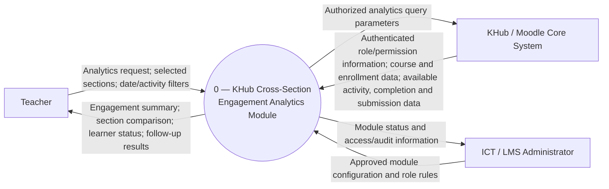

# MIT 103 - Deliverable 1: System Proposal

## KHub Cross-Section Engagement Analytics Module for Philippine Science High School - Bicol Region Campus

**Prepared by:** Roffe R. Fajardo  
**Program:** Master of Information Technology - MIT 1A  
**Course:** MIT 103 - Advanced Systems Analysis, Design and Implementation  
**Instructor:** Rowell John B. Artiaga  
**Institution:** Partido State University, College of Engineering and Computational Sciences  
**Document version:** 1.0 - consolidated proposal draft  
**Prepared:** 10 October 2026  
**Project organization:** Philippine Science High School - Bicol Region Campus (PSHS-BRC)

---

# 1. Organisational Context

## 1.1 The organization and its learning environment

Philippine Science High School - Bicol Region Campus (PSHS-BRC) is the setting for the proposed information-system enhancement. The campus uses **KHub**, a Moodle-based learning management system (LMS), to support teaching, learning-material distribution, activity submissions, and monitoring. The proposed project concerns teachers' use of KHub to monitor learning engagement across multiple course-sections. It does not attempt to redesign the school's wider student-information or academic-record systems.

KHub provides **Study Guides**, delivered through Moodle Book resources; **Assignment activities** for collecting outputs; a **Grader report** that summarizes grades; and an **Activity report** that exposes activity views and last-access information. These functions create a digital record of learner interactions and support routine teaching decisions. The same brief records a practical limit: monitoring across four course-sections involves separately opening four Activity reports. That example is the principal locally documented workflow issue on which the proposal is based; it is not a measured campus-wide prevalence estimate.

KHub's information is organized around authenticated users, their course-section enrollments or roles, learning activities, and the activity and submission records generated within those courses. As described in the earlier work, access is limited to institutional KHub accounts and to the course-sections a user may access. This means that useful analytics cannot be considered separately from permission checks, privacy, and ownership of the original learning records. The course-section, rather than the entire school, is therefore the relevant access boundary for a teacher-facing first release.

The proposed module is an **extension to the existing environment**. KHub remains the authoritative source of courses, enrollment, activities, submissions, and any available completion and access events. The module would retrieve only permitted information, summarize it, and display the results. It would neither replace existing Moodle activities nor modify grades, submissions, or completion records. The exact integration mechanism supported Moodle plugin, reporting API, or another approved read-only interface—requires technical confirmation from the KHub/LMS administrator.

## 1.2 Roles and decision relationships

The proposal is situated in the following **functional** structure. This is a description of decision relationships for the project, **not** a claim that an official PSHS-BRC organizational chart has been verified:

| Functional group | Relationship to KHub | Proposed relationship to this project |
|---|---|---|
| Campus leadership / approving authority | Sets organizational priorities and approves institutional changes | Reviews value, risks, resourcing, and permission to introduce a module |
| ICT / LMS administrator | Administers KHub configuration, accounts, roles, and technical environment, as described in prior work | Confirms integration method, security controls, maintenance responsibility, and deployment readiness |
| Teachers | Publish or manage teaching activities and review student work in their permitted sections | Primary users; define information needs and validate the usefulness of analytics |
| Learners | Access materials and create learning records through normal course activities | Data subjects and indirect beneficiaries; not direct analytics users in the first release |
| Potential academic coordinators / unit heads | May need summaries for instructional follow-up | Possible later stakeholders only; access and requirements are not yet confirmed |
| Privacy / data-governance reviewer, if designated | Reviews appropriate handling of learner records | Provides necessary privacy review before live learner data are used; actual approval authority must be established |

## 1.3 Management levels served

**Operational level - primary release.** A teacher needs to know whether learners have viewed, submitted, or completed an activity during a defined period and which recorded cases merit checking. The module would provide permitted learner-level and section-level information, backed by source indicators and timestamps. The teacher, rather than the software, decides what follow-up is appropriate.

**Tactical level - potential later extension.** A subject or academic coordinator may wish to compare aggregated activity patterns across teaching groups or terms to identify areas where additional support is warranted. Such a use case could inform professional support or activity planning, but it requires separate authorization, a confirmed organizational role, and evidence that the comparison is methodologically fair. Tactical access is **not** part of the initial teacher-focused release.

**Strategic level - excluded from current scope.** School leaders may eventually want long-term, school-level adoption or engagement indicators. 

## 1.4 Organizational culture and implications for design

Observed was a relatively centralized, role-controlled operating pattern in KHub: institutional authentication, access limited by courses and roles, and administrative rather than individual-teacher control over the underlying LMS. This is a **bounded characterization of KHub governance**, not a definitive assessment of the entire campus's organizational culture. An administrator interview could confirm or correct it.

Three design implications follow. First, the module should **inherit or enforce existing authorization**; a teacher's interest in comparing sections must not create access to an otherwise unauthorized class. Second, the analytics output should remain **traceable to observable records**- for example, last view or submission status-rather than translate a limited digital indicator into an unsupported evaluation of a learner. Third, new configuration and deployment require **administrator involvement**, even if teacher requirements drive the interface.

A more decentralized alternative would let individual teachers independently combine arbitrary course data and configure shared reporting. That might improve flexibility, but it creates permission ambiguity and maintenance risk in the currently described environment. The proposal instead favors a centrally approved, read-only analytics service with teacher-selected filters constrained to their existing access. This recommendation remains subject to the institution's confirmation of actual KHub governance and the handling of learners' personal information.

## 1.5 Project boundary and objectives

**Included in the proposed initial release:** teacher authorization checks; selection of permitted course-sections; retrieval of available enrollment, activity-view, completion, and submission information; limited, clearly defined cross-section summaries; per-learner detail restricted by course permissions; and teacher-selected follow-up filters.

**Excluded:** changing source grades or completion records; predictive risk scores; behavioral labels; teacher access to other teachers' sections without permission; school-wide executive analytics; and replacement of core Moodle functions.

The primary project objective is to determine whether the documented multi-report monitoring workflow can be made less fragmented **without weakening access control, source accuracy, or teachers' judgment**. Success will be evaluated using confirmed user needs, source-record correctness, authorized-access tests, and a measured before-and-after workflow once data access and participants are approved.

# 2. Problem Statement

## 2.1 Current condition and evidence

KHub produces useful activity information, but the existing teacher-facing reporting process is **section-oriented**. Checking engagement across **four sections** required opening **four separate Activity reports**. The reports could show per-item views and last access, while grade and submission information appeared in other existing KHub facilities. Thus, the teacher was required to move among reports before forming a cross-section picture of engagement.

This is a specific workflow-fragmentation problem, not proof that KHub lacks engagement tracking. The existing reports work for their respective purposes; what is not readily available in the documented workflow is a consolidated authorized comparison of several sections. The cost currently supported by evidence is **repeated navigation and manual synthesis**, rather than a verified amount of time, money, or error. No timed study, error count, or independently interviewed teacher testimony has been submitted.

| Evidence | What it establishes | What it does **not** establish |
|---|---|---|
| `E-01`: author's Week 2 profile of KHub | Four course-sections required four separate Activity reports in the described workflow | Average minutes wasted, frequency across all teachers, or a measured institutional cost |
| `E-01`: teacher-account description of reports | Views / last access, assignments and grade summaries exist in KHub | That all metrics can be joined correctly through a supported interface |
| `E-02`: Week 3 system worksheet | A proposed multi-section analytics flow and plausible teacher use cases | Independent confirmation that stakeholders want every proposed feature |
| `E-04`: Week 4 interview guide | A method for testing workflow, exceptions, trusted indicators and permissions | Interview findings; no interview responses are supplied |
| `E-05`: Week 5 SRS | A coherent preliminary set of candidate requirements | Technical feasibility or stakeholder validation of the candidates |

## 2.2 Problem definition

**Problem:** For a teacher responsible for multiple KHub course-sections, available engagement information is accessed through separate section-level reports. In the author's documented four-section example, this requires four separate Activity-report openings and manual cross-section synthesis. The fragmented workflow makes it harder to obtain a single, permission-consistent overview for selecting cases that deserve teacher follow-up. The magnitude of the resulting time burden, error exposure, and effect on follow-up timeliness **has not yet been measured**.

The affected workflow is limited to **teacher monitoring of already-authorized course-sections**, not all learning analytics at PSHS-BRC. The proposed module is a candidate response to this problem, **not the definition of the problem**.

## 2.3 Impact, baseline, and questions requiring validation

The defensible baseline is **four report openings for a four-section comparison in the author's example**. The corresponding baseline for total clicks, elapsed time, interpretation accuracy, and follow-up decisions is unknown. Treating a four-to-one screen change as a guaranteed time saving would be unsupported; the consolidated view could have its own loading, filtering, or interpretation costs.

A short validation exercise should therefore ask authorized teacher participants to complete the same specified monitoring task using the existing reports and, later, a prototype. Measure total elapsed time, steps/reports opened, correctness of selected records, and whether the teacher considers the information sufficient to decide on follow-up. Do not collect identifiable learner screenshots for a class submission without authorization and anonymization.

The open problem questions are: How often is this task performed? Which indicators do teachers trust? Which cases are misleading or incomplete? Are activity logs technically and semantically comparable across courses? What actual reporting/permission boundaries constrain an approved implementation? A different finding—for example, that teachers only need a simpler workflow tutorial or an existing Moodle report configuration—could reduce or eliminate the case for a new module.

# 3. Stakeholder Map

Influence is assessed **provisionally** based on the role, not on an interview. The term *veto* distinguishes formal approval or control from a person's ability to reject the user experience. Formal rights must be verified locally.

| Stakeholder | Interest / information need | Influence | Potential veto or stop condition | Proposed engagement |
|---|---|---|---|---|
| Teachers using multiple sections | Fewer fragmented checks; reliable, interpretable indicators | High on usability / medium on institutional approval | No confirmed formal veto; may reject an unusable workflow | Workflow interviews, questionnaire, prototype walkthrough |
| ICT / LMS administrator | Secure integration, stability, supportability and compatible permissions | High | **Technical deployment stop** if integration is unsafe or unsupported; authority to be confirmed | API/permission discovery, technical review, security tests |
| Campus leadership / authorized project sponsor | Educational value, cost, institutional policy compliance | High | **Institutional approval/funding stop**, subject to delegated authority | Review decision brief, feasibility and pilot outcomes |
| Learners | Fair interpretation of their activity and protection of their records | Low formal project influence; high impact | No assumed formal veto; rights and privacy requirements remain binding | Minimize access and identifiers; avoid behavioral labels |
| Designated privacy/data-governance authority, if applicable | Lawful use, access minimization and retention rules | High for privacy review | **Privacy clearance stop** if required controls/authorization are absent; role to be identified | Review data flows, permissions, anonymization and retention |
| Course / academic coordinator (potential later user) | Summary information across teaching groups | Medium, unconfirmed | No known veto; release expansion requires separate authorization | Defer scope discussion pending teacher pilot |
| System developer / maintainer (to be identified) | Clear specifications, testability, maintainability | Medium to high | May identify blocking constraints; no assumed formal veto | Technical spike, estimation, maintainability assessment |

**Engagement priority:** Teachers validate the problem and interfaces; the administrator validates available data and access; the sponsor and applicable governance authority decide whether the institution should proceed. A teacher-friendly screen alone does not override a technical or privacy stop condition.

**Change-management risk:** The proposing teacher is not assumed to be the person who administers or deploys KHub. The Week 2 brief described the author's role as closest to *agent of change*: advocating and validating the improvement while remaining accountable for helping colleagues adopt it. This split between proposer and implementer requires explicit ownership at deployment.

# 4. Context-Level Data Flow Diagram

**Process 0: KHub Cross-Section Engagement Analytics Module**  
**System boundary:** only the proposed analytics module. **External entities:** Teacher, KHub/Moodle Core System, and ICT/LMS Administrator. There is **exactly one process**; no internal subsystem or data store is decomposed here.

**Context-balancing description:** The module receives a teacher's scope and filters, checks which data the teacher may access, requests data from KHub, and presents analytics limited to the approved scope. The administrator supplies or approves configuration and receives relevant audit/status information. The proposed module does **not** send grade changes, completion updates, or new learning records to KHub. The arrows represent **proposed logical data exchanges**, not proof that a particular Moodle API exists. 

# 5. Two Full Use Case Scenarios

## UC-01 — View and compare engagement across authorized sections

| Field | Description |
|---|---|
| Primary actor | Teacher |
| Goal | Obtain a consolidated, source-supported engagement summary for two or more authorized KHub course-sections |
| Trigger | Teacher needs to review recent course activity across multiple teaching sections |
| Preconditions | Teacher is authenticated; KHub records exist; the module can verify course permissions; data access has been approved |
| Success condition | The teacher receives a comparison for only authorized sections with indicators and dates that can be checked against KHub |

**Main success flow**

1. The teacher signs in through KHub and opens the analytics module.
2. The module obtains the authenticated user's permitted course-section scope from KHub.
3. The module lists only those permitted sections.
4. The teacher selects at least two sections and specifies the date interval and available activity criteria.
5. The module validates that each selected section remains authorized and that the requested indicators exist.
6. The module retrieves the required records through an approved, read-only KHub interface and applies the same defined calculation/filter rules across supported sections.
7. The module displays a cross-section summary and per-section values, together with relevant indicator definitions and period boundaries.
8. The teacher reviews the information and may open section-level details for clarification.

**Alternate / exception flows**

- **A1: Only one authorized section.** At Step 3, the teacher selects one available section. The module displays a single-section summary without implying that a comparison is possible.
- **A2: Unauthorized section requested.** At Step 5, validation fails. The module refuses the request and displays no data from that section; the incident is handled under the approved audit policy.
- **A3: Missing or incomparable indicators.** At Step 6, a requested measure is not enabled or cannot be made comparable. The module marks that measure unavailable or excludes it with an explanation; it must not silently represent missing data as zero.
- **A4: Retrieval failure.** At Step 6, the module reports that the selected period could not be processed; it does not display incomplete results as a complete report.

## UC-02 - Identify records requiring teacher review

| Field | Description |
|---|---|
| Primary actor | Teacher |
| Goal | Identify learners who match a specified observable KHub activity criterion, without automatically judging their motivation or performance |
| Trigger | Teacher wants to prioritize checks or follow-up after reviewing the authorized engagement summary |
| Preconditions | UC-01 data is accessible; the teacher has permission for the specific learner records; the selected criterion is supported by KHub data |
| Success condition | The teacher receives a record-backed filtered list, reviews context, and decides on next actions independently |

**Main success flow**

1. The teacher opens an authorized engagement summary.
2. The teacher selects a criterion such as no recorded view in the selected interval, no recorded submission for an applicable assignment, or incomplete status **where that measure is enabled and defined**.
3. The module shows the definition of the chosen criterion and applies it to eligible records.
4. The module displays matching learners together with the section, relevant activity, source status and available timestamp or supporting evidence.
5. The teacher checks particular cases against KHub and classroom context before deciding whether any follow-up is necessary.
6. The teacher closes the report or changes the filter. No learner grade, submission, or completion record is modified.

**Alternate / exception flows**

- **B1: Criterion unavailable.** At Step 2, the requested data is not collected for that activity; the option is disabled or clearly identified as unsupported.
- **B2: No matching records.** At Step 4, the module returns an empty result with the selected scope/criterion visible, rather than interpreting that as a guarantee of learning engagement.
- **B3: Stale or incomplete data.** At Step 4, the module warns that some underlying records are unavailable or not current, and does not label a learner negatively.
- **B4: Permission changes during request.** The module rechecks access and withholds results that are no longer authorized.

# 6. Elicitation Instruments and Method Rationale

## 6.1 Interview guide - designed, not yet administered

**Target role:** PSHS-BRC teacher who manages multiple KHub course-sections 
**Method:** Semi-structured individual interview.  
**Structure:** **Diamond**-begin with verifiable facts, open into concrete workflow experiences, then narrow to permission constraints and overlooked issues.  
**Recording and consent:** Request informed consent; record only with permission; anonymize in submitted notes. No interview date, transcript, quotations or consent record were included in the supplied materials.

**Objectives:** (I1) reconstruct actual monitoring workflow; (I2) determine trusted information for follow-up; (I3) identify exceptions and manual workarounds; (I4) clarify access boundaries.

| # | Type | Question | Objective |
|---|---|---|---|
| 1 | Closed (C) | How many KHub course-sections are you currently handling this term? | I1 / context |
| 2 | Closed (C) | On a typical week, how often do you check learner activity or completion information in KHub? | I1 |
| 3 | Open (O) | Walk me through the last time you checked learner engagement across more than one section, from the first KHub page you opened until you decided what action to take. | I1 |
| 4 | Probe (P) | What happened the last time the information you needed was not available in the first KHub report you opened? | I3 |
| 5 | Open (O) | What information do you normally look at before deciding that a learner may need follow-up? | I2 |
| 6 | Probe (P) | Can you give me a recent example when the KHub information and what you observed from the learner did not seem to match, and what did you do next? | I2, I3 |
| 7 | Closed (C) | Are there course-sections, reports, or learner information in KHub that you cannot access because of your current role or permissions? | I4 |
| 8 | Open (O) | What should I have asked you? | All |

**Rationale and correction.** The source Week 4 guide  intentionally replaced the leading, hypothetical question *“Would a cross-section dashboard make it easier for you to monitor students?”* with Question 3, which asks for a real recent experience without naming the preferred solution. The diamond sequence is suitable for an experienced user who can establish factual context before describing exceptions and returning to concrete access rules. The interviewer should probe for a specific activity, date, report, and decision without implying that the current system is deficient. A closing follow-up outside the eight core questions may ask which other roles would provide a competing view.

## 6.2 Questionnaire - proposed complementary instrument

**Status:** Prepared for validation; **not distributed** in the supplied record.  
**Audience:** Teachers who use KHub (especially those with two or more course-sections).  
**Method:** Short, anonymous, self-administered questionnaire; one concrete recall period where possible. Do not collect student names, grades, login IDs, or screenshots.

| # | Item | Response format | Purpose |
|---|---|---|---|
| Q1 | How many KHub course-sections are you currently responsible for? | Integer | Segment respondents by workload |
| Q2 | During the last teaching week, on how many days did you check activity, completion or submission information in KHub? | 0–5 or other count | Estimate frequency without a vague “often” |
| Q3 | For the most recent multi-section check, which reports or pages did you open? | Multiple select + Other | Document actual report path |
| Q4 | About how long did your most recent multi-section check take, from opening the first report to obtaining the information needed? | Minutes / cannot recall | Estimate perceived elapsed time; verify separately |
| Q5 | Which existing KHub indicators did you use in that check? | Multiple select: views, last access, submission status, completion status, grades, other | Identify actual indicator usage |
| Q6 | How confident were you that those indicators reflected the specific activity you wanted to review? | 1–5 + “cannot assess” | Detect uncertainty about interpretation |
| Q7 | What, if anything, made the most recent check difficult? | Open text, “nothing” permitted | Capture unanticipated problems |
| Q8 | Have you encountered a case where KHub activity did not match what you knew from class? | Yes / No / Unsure, optional explanation | Test mismatch or exception claims |
| Q9 | What reports or information can you not access because of your KHub permissions, if any? | Open text / not sure | Test access assumptions |
| Q10 | What existing function, change, or support would most improve this task, if anything? | Open text | Avoid steering respondents to a new dashboard |

**Rationale.** The questionnaire captures variation across teachers that one key-informant interview cannot establish. Its recall window reduces generalization error; mixed closed/open items allow aggregation while retaining alternatives such as “no problem.” Questions do not presume a particular solution, and Q10 explicitly allows an existing report or training to be preferable. Responses should be reported with actual sample size and non-response limitations; no response counts are fabricated here.

## 6.3 JAD and method selection

A **Joint Application Development (JAD)** session could bring teachers, the ICT/LMS administrator and a decision-maker together to reconcile terminology, access rules, and priorities **after** separate workflow evidence has been gathered. However, using JAD as the first elicitation method risks prematurely converging on a dashboard design and may inhibit teachers from discussing workarounds in front of system administrators. The proposal therefore prioritizes an individual interview, anonymous questionnaire, unobtrusive document analysis, and observation. A small JAD-style validation session is **conditional**, not claimed as completed.

## 6.4 Unobtrusive methods planned

- **Document analysis:** Review anonymized Activity-report, Assignment-status and completion/report field labels and meanings using a permission-approved demonstration account or redacted examples. Record `document ID`, field, interpretation, and source owner. Distinguish a missing event from an unavailable or disabled indicator.
- **STROBE observation:** Apply structured observation of reporting activity and work environment to the natural multi-section checking workflow (Kendall & Kendall, 1984). Record what screens/reports are opened, interruptions, handwritten comparison notes, report-layout cues, and differences between stated procedures and observed actions. Do not record identifiable learner records.
- **Task timing/sample:** With permission, observe several monitoring tasks and report actual sample sizes, number of sections, clicks, elapsed time, and errors. Separate a prototype demonstration from production evidence.

# 7. Elicitation Evidence and Source Register

## 7.1 Evidence inventory (anonymized)

| ID | Source material | Evidence type | What is supported | Strength / limitation |
|---|---|---|---|---|
| **E-01** | `Week1-2/OUTPUT_DecisionBrief_KHub.pdf` (15 Aug 2026) | **Author-reported teacher-account review** | Existing Study Guides, Assignments, Grader report, Activity report; four sections / four reports; institutional/section-scoped access; methodology decision | Directly grounded in a prior submission, but not independently corroborated by system screenshots or another user |
| **E-02** | `Week3/OUTPUT_Week3_Student_Worksheet_KHub_Completed_rrf.md` (22 Aug 2026) | **System model / analyst reflection** | Context boundary, proposed data flows, management-level needs, use cases, role-controlled culture | A design/model source, **not** independent observation or interview evidence |
| **E-03** | Week 3 ER model contained in `E-02` | **Conceptual model** | Candidate TEACHER, COURSE_SECTION, LEARNER, ENROLLMENT, ACTIVITY, ACTIVITY_EVENT relationships | Unverified cardinality, storage and schema; **not** an inspected KHub database |
| **E-04** | `Week4/OUTPUT_Fajardo_Week4_InterviewGuide.pdf` | **Interview instrument** | Eight non-leading questions; diamond sequencing; four elicitation objectives | Instrument design only; **no interview responses or quotations** |
| **E-05** | `Week5/OUTPUT_Fajardo_SRS_Outline_KHub.md` | **Preliminary analyst-authored SRS** | 14 candidate functional and 9 non-functional items; assumptions; scope and verification plan | Requirements draft, **not external validation**; some are supported only by `E-02` or analyst decisions |

**Not supplied / not completed in the evidence package:** `INT-01` completed interview transcript and consent record; `QUE-01` completed questionnaire with response counts; `DOC-01` actual redacted LMS-report document-analysis sheet; `OBS-01` contemporaneous STROBE notes or checklist; `SAM-01` task-timing data and comparison results. These reserved IDs must **not** be cited as completed evidence until records exist.

## 7.2 Presently supported findings and source interpretation

1. **Documented repeated report navigation (`E-01`, O):** The author describes opening four Activity reports to monitor four course-sections. This supports the existence of a fragmented workflow **for the author's case**. It does not measure time loss or prove general campus need.
2. **Documented observable indicators (`E-01`, O):** KHub exposes item views/last access, assignment workflows and grade summaries in existing facilities. Exact log semantics, completion enablement and cross-course comparability need administrator review.
3. **Permission boundary (`E-01`, O; `E-02`, M):** KHub access is described as institutional and course-scoped. Enforcing existing permissions is therefore a defensible baseline control; the implementation of role resolution remains unconfirmed.
4. **Possible follow-up use case (`E-02`, M; `E-05`, D/U):** Filtering by absent views/submissions or incomplete status is plausible, but there is no interview result establishing which criterion teachers prefer or the risk of false interpretation.
5. **Integration feasibility (`E-05`, U):** The SRS names potential Moodle interfaces. No actual API, plugin compatibility result, or test access has been provided. Feasibility is conditional.

## 7.3 Missing evidence and collection record

| Planned artifact | Collection method and capture fields | Status |
|---|---|---|
| `INT-01` | Interview date, participant role, consent, verbatim quotation/answer, analyst inference, question number | **Pending** |
| `QUE-01` | Anonymized response export, recruitment method, invited/responded counts, questionnaire version | **Pending** |
| `DOC-01` | Redacted report screenshot/field list, report type, field definitions, source account/permissions, interpretation | **Pending** |
| `OBS-01` | Structured STROBE checklist: screen sequence, artifacts, interactions, exceptions, environmental cues; observation date | **Pending** |
| `SAM-01` | Task criteria, sampling frame, baseline task count, number of sections, completion time, steps, errors | **Pending** |
| `ADM-01` | Authorized administrator confirmation of API, role checks, deployment constraints and data governance | **Pending** |

**Analytical control:** Analyst inference must never be quoted as an interview response or presented as a system log. For every new evidence record, document what was seen or said, what was inferred from it, any contradictory observation, and its effect on requirement status. If observation contradicts the proposed requirement, amend or remove the requirement rather than force the evidence to fit the design.

# 8. Requirements Set - ISO/IEC/IEEE 29148:2018-Aligned SRS

## 8.1 Introduction, perspective, and definitions

**Purpose.** Specify the initial, permission-limited KHub cross-section analytics module for the proposer, teachers, authorized KHub administrators, potential implementers, and assessors.

**Product perspective.** Read-only analysis of KHub-origin records. The existing LMS owns authentication, roles, course sections, enrollments and activities. The module owns only the request-and-presentation logic for an analytics view. It does not modify source-grade or completion values.

**Definitions.** *Engagement indicator* = an explicitly named recorded KHub measure, not a psychological inference; *course-section* = a KHub course or section within the teacher's authorized access; *follow-up result* = a filtered list for teacher judgment, not a diagnostic risk classification; *authorized scope* = sections and learner records the current authenticated teacher is permitted to inspect.

**Conventions.** `must`, `should`, and `could` indicate proposed relative priority; they do not imply that all items have been validated. `O/M/D/U` marks provenance as defined on the cover. Verification methods are planned acceptance checks, not completed tests.

## 8.2 Constraints, assumptions, and exclusions

| ID | Constraint, assumption, or dependency | Status / consequence |
|---|---|---|
| C-01 | Access must remain within existing KHub roles and course-section authorizations (`E-01`). | Baseline constraint; technical implementation to confirm |
| C-02 | KHub records are the authoritative inputs (`E-01`, `E-02`). | Architectural decision; read-only interface required |
| C-03 | Grade and completion data must not be modified by analytics (`E-01`, `E-05`). | Analyst-imposed first-release boundary |
| A-01 | A supported, administrator-approved route exists to retrieve needed information. | **Unverified; deployment blocker if false** |
| A-02 | Relevant indicators are available and comparable enough to summarize between sections. | **Unverified; compare only defined compatible indicators** |
| A-03 | Teacher-to-section permissions can be checked reliably for each request. | **Unverified; security blocker if false** |
| A-04 | Teachers find these indicators useful for some follow-up decisions. | **Unverified; requires real elicitation** |
| A-05 | Week 3's teacher-to-section many-to-many relation matches actual KHub data. | **Unverified; revise model if false** |

**Excluded from Release 1:** grade editing; automated student behavioral/risk labels; access to unauthorized sections; executive school-wide dashboards; replacement of KHub.

## 8.3 Functional requirements

The following retain the **14 identifiers** used in the Week 5 SRS, for trace continuity. A `M/D/U` item is explicitly **provisional** until an independent source confirms its need and the technical study establishes feasibility.

| ID | Requirement (“shall”) | Priority | Named origin | Provenance | Planned verification | Use case |
|---|---|---|---|---|---|---|
| FR-01 | The module shall list only the course-sections that the authenticated teacher is authorized to access in KHub. | Must | E-01, E-02 | O/M | Role-scoped access test | UC-01 |
| FR-02 | The module shall deny analytics access to a course-section outside the teacher's existing authorization. | Must | E-01, E-02 | O/D | Unauthorized-request negative test | UC-01 |
| FR-03 | The module shall permit selection of one or more authorized course-sections. | Must | E-02, E-04 | M/U | UI demonstration + user validation | UC-01 |
| FR-04 | The module shall permit selection of a date interval for retrieved activity information. | Should | E-02, E-04 | M/U | Filter demonstration + user validation | UC-01 |
| FR-05 | The module shall permit filtering by those activity indicators supported for the selected sections. | Should | E-02, E-04 | M/U | Supported/unavailable indicator tests | UC-01 |
| FR-06 | The module shall retrieve the enrollment information necessary to associate learners with each authorized selected section. | Must | E-02, E-03 | M/U | Source-record reconciliation | UC-01 |
| FR-07 | The module shall retrieve available activity/view records for the selected authorized sections and interval. | Must | E-01, E-02 | O/M | Known-record comparison | UC-01 |
| FR-08 | The module shall retrieve completion or submission status only for supported activities and authorized sections when the selected report uses those indicators. | Should | E-01, E-02 | O/M/U | Status/permission test | UC-01, UC-02 |
| FR-09 | The module shall generate a consolidated engagement summary of the selected authorized sections using documented indicator definitions. | Must | E-01, E-02 | O/D | Aggregate versus source comparison | UC-01 |
| FR-10 | The module shall display authorized learner-level engagement information within its corresponding course-section context. | Must | E-02, E-04 | M/U | Display and access-control test | UC-01, UC-02 |
| FR-11 | The module shall allow filtering of authorized learner records by supported observable indicators (e.g., recorded view, applicable submission status, enabled completion status). | Should | E-02, E-04 | M/U | Filter demonstration + user validation | UC-02 |
| FR-12 | The module shall show source-backed results of a selected follow-up filter without assigning automatic behavioral or academic judgments. | Must | E-02, E-05 | M/D | Content inspection + demonstration | UC-02 |
| FR-13 | Analytics requests shall not modify KHub grade or completion records. | Must | E-01, E-05 | O/D | Before/after integrity test | UC-01, UC-02 |
| FR-14 | Administrative configuration controls, if needed, shall be available only to authorized KHub/LMS administrators. | Should | E-02, E-05 | M/D/U | Role-based administrative test | Admin support |

**Requirement quality note:** `FR-08`, `FR-09` and `FR-11` need an administrator-approved definition of each indicator and missing-data treatment before test cases can be finalized. `FR-03`–`FR-06`, `FR-10`–`FR-11` and `FR-14` are particularly dependent on validation beyond the analyst's models. The interview guide (`E-04`) defines a way to gather evidence; it does **not** itself prove a requested feature.

## 8.4 Non-functional requirements - ISO/IEC 25010:2023 categories

| ID | Characteristic | Candidate quality requirement | Measure / target | Origin | Status |
|---|---|---|---|---|---|
| NFR-01 | Security | Analytics shall expose **zero** course-sections outside current KHub authorization. | Unauthorized course-sections returned = **0** | E-01 | Baseline / verify |
| NFR-02 | Security | Analytics shall expose **zero** learner records outside the user's permitted course-section scope. | Unauthorized learner records returned = **0** | E-01 | Baseline / verify |
| NFR-03 | Functional suitability | One analytics request shall support at least **two** authorized sections where comparable data exist. | Concurrent sections ≥ **2** | E-01, E-02 | Proposed target; verify |
| NFR-04 | Compatibility | Supported analytics shall reuse KHub-held information without requiring manual re-entry of the source learner activity events. | Duplicate source event-entry steps = **0** | E-01, E-05 | Analyst requirement; technical check |
| NFR-05 | Reliability | Running analytics shall not change grades or completion status in KHub. | Changed source records = **0** | E-01, E-05 | Analyst control; verify |
| NFR-06 | Interaction capability | Teachers shall access consolidated results for selected authorized sections without opening a separate KHub Activity report for **each** section. | Separate reports required for supported task = **0** | E-01 | Baseline response; usability test |
| NFR-07 | Performance efficiency | An acceptable response-time threshold shall be specified **after** baseline data volume and user expectations are measured. | Response time in seconds; **target TBD** | E-05 | **Open requirement candidate, not acceptance-ready** |
| NFR-08 | Maintainability | Integration should use administrator-approved supported Moodle/KHub reporting or plugin interfaces, without duplicating core LMS record-management logic. | Approved interface and maintainability review | E-01, E-05 | Technical validation pending |
| NFR-09 | Flexibility | New engagement indicators should be definable without altering authoritative KHub learning records. | Configuration/design review; target TBD | E-05 | **Open design objective, not acceptance-ready** |

**Do not claim full verification readiness:** NFR-07 and NFR-09 lack agreed measurable acceptance thresholds. They should be finalized after administrator discovery, teacher interviews, and prototype testing rather than assigned arbitrary seconds or effort estimates. The listed characteristics follow the product-quality terminology used in ISO/IEC 25010:2023.

## 8.5 External interface requirements

**User interface:** authenticated teacher view, authorized section selector, date and activity filters, consolidated summary, permitted learner drill-down, definitions/availability notices, and filtered follow-up results. Administrator controls are conditional on the approved integration design.

**Software:** existing Moodle/KHub authentication and permission checks; course/enrollment information; available activity/view events; optional completion and assignment-submission status. Specific API endpoints, database tables, event meaning, retention, and version compatibility are **not established** by the current evidence.

**Hardware:** no special end-user hardware is proposed beyond a device able to access the existing web LMS; accessibility and actual device requirements require verification.

**Communications:** use the institution's approved secure KHub connection path; do not assume external export, third-party analytics hosting, or public access.

## 8.6 Verification and traceability plan

| Verification group | Requirement IDs | Evidence to be produced in testing |
|---|---|---|
| Permission boundaries | FR-01, FR-02, FR-14, NFR-01, NFR-02 | Access test matrix using approved role/section combinations and denied cases |
| Selection and filtering | FR-03, FR-04, FR-05, FR-11 | Walkthrough record, valid/invalid cases, agreed indicator definitions |
| Read-only data integration | FR-06, FR-07, FR-08, FR-13, NFR-04, NFR-05, NFR-08 | Approved interface documentation, source-to-result reconciliation, integrity tests |
| Analytics and interpretation | FR-09, FR-10, FR-12, NFR-03, NFR-06 | Reproduced source values, task observations, teacher acceptance notes |
| Open quality targets | NFR-07, NFR-09 | Baseline measurement, stakeholder-approved threshold, later acceptance test |

### Requirement-to-source traceability summary

| Source | Supported observation, model or proposed decision | Related requirements | Evidence status |
|---|---|---|---|
| E-01 | Four separate section Activity reports in author's workflow | FR-03, FR-09; NFR-03, NFR-06 | Author-reported; independently unverified |
| E-01 | Teacher-account report shows activity information | FR-07, FR-08 | Author-reported; interface details unverified |
| E-01 | Role/course boundary | FR-01, FR-02; NFR-01, NFR-02 | Author-reported; technical check required |
| E-01 + E-05 | Conservative treatment of grade/completion data | FR-13; NFR-05 | Analyst governance decision based on source risk |
| E-02 | Context diagram and two teacher use cases | FR-03–FR-06, FR-09–FR-12 | Model-origin **not** independently elicited |
| E-03 | Candidate relationships and enrollment join | FR-06–FR-10 | Preliminary ER model; schema unverified |
| E-04 | Planned questions about filters, workarounds and access | FR-03–FR-05, FR-10–FR-11 | **Instrument only; no answers** |
| E-05 | Preliminary requirements and design objectives | FR-12–FR-14; NFR-04, NFR-07–NFR-09 | Analyst-authored candidates; validate |

**Traceability conclusion:** Every line has a **named origin**, but not every line yet has **independently elicited requirement evidence**. That distinction matters: source attribution is not equivalent to requirements validation. The next revision must connect validated needs to `INT-01`, `QUE-01`, `DOC-01`, `OBS-01`, `SAM-01`, or `ADM-01` records before labeling those requirements stakeholder-confirmed.

# 9. Feasibility Assessment

**Assessment basis:** preliminary and qualitative. There is no administrator-approved integration proof, vendor quotation, software cost record, measured monitoring workload, or formal sponsor decision in the provided materials. The decision at this stage is therefore **conditional feasibility for a constrained prototype**, not approval for production deployment.

## 9.1 Technical feasibility - conditionally feasible

KHub already has the relevant broad classes of information—courses, enrolled users, teacher-permitted sections, activity records, assignments and, in some cases, completion information (`E-01`). Reusing these sources makes a read-only extension more plausible than building an entirely new LMS. The Week 2 weighted decision matrix favored **Object-Oriented Systems Analysis and Design (OOSAD)** at **3.75** over traditional **SDLC** at **3.45** and **Agile** at **3.00** for the hypothetical module. The recommendation was **OOSAD as the primary modeling approach with SDLC documentation checkpoints** for grade- and completion-related data paths (`E-01`). These scores are the author's prior evaluation, **not** independent proof of implementation feasibility.

The major technical unknowns are access to a supported Moodle integration route, the meaning/completeness of activity logs, authorized role resolution, comparison rules across sections, current KHub version, capacity, and maintenance ownership. A prototype using invented or synthetic records is technically achievable without touching live learner data; connecting it to production is not justified until an authorized technical spike confirms `A-01`–`A-03`.

**Alternative considered:** scraping teacher-facing report pages or manually exporting multiple reports may offer a low-barrier demonstration, but screen scraping would be brittle under UI changes and potentially insecure if it bypasses supported authorization methods. Prefer a supported, administrator-reviewed interface. If no such interface is available, **do not proceed with direct LMS integration**.

## 9.2 Operational feasibility - plausible, pending users and governance

The module targets an existing task rather than a newly invented teacher process. The proposing teacher is familiar with KHub's current reports (`E-01`); however, one user's familiarity does not establish campus-wide demand. Operational acceptance depends on teacher interviews, a short questionnaire and prototype walkthroughs confirming that the consolidated output is trustworthy and actually reduces task burden.

Teachers remain responsible for interpreting indicators and verifying circumstances such as a learner completing work offline or a report not recording a view. The design avoids automated labels and leaves source records unchanged. Administrator review is necessary because the proposing teacher may not control integration or deployment. A successful pilot requires a named module owner, approved user scope, technical support arrangement, and a means to report wrong/missing analytics.

**Operational stop condition:** No real user validation, no module owner, or a privacy/permission model that cannot be approved should prevent production release.

## 9.3 Economic feasibility - insufficient data for a financial benefit claim

The most plausible benefits are reduced navigation, fewer repeated comparisons and faster preparation for teacher follow-up. None has been valued in pesos or measured in minutes. The initial cost categories are analyst/developer effort, administrator time, testing, training, hosting or infrastructure if additional capacity is necessary, and ongoing maintenance. Existing KHub infrastructure may reduce additional costs, but **zero added cost cannot be assumed**.

A defensible cost-benefit study would use these variables:

- `T_old` = observed mean minutes per teacher for the defined current multi-section task.
- `T_new` = observed mean minutes for the same task with the prototype.
- `F` = number of times the task is performed per teacher in a chosen period.
- `U` = number of participating teachers with that workflow.
- `R` = documented cost value per staff hour, **if** the institution approves a monetary conversion.
- `C_dev + C_admin + C_train + C_maint` = estimated build, administration, training and maintenance costs for the same horizon.

**Potential time released (hours)** = `max(T_old − T_new, 0) × F × U ÷ 60`.  
**Illustrative monetary value (only if justified)** = `time released × R`.  
**Net value (if quantified)** = `illustrative value − total costs`.

**No values are supplied for these variables.** Consequently, this proposal does not claim a payback period, return on investment, or a quantified efficiency improvement. Time released may improve instructional work without reducing actual payroll expenditure, so it must not automatically be counted as cash savings.

**Alternatives for economic comparison:** (A) retain current KHub reports plus a short monitoring checklist; (B) use an administrator-approved report export with a local comparison worksheet; or (C) build the integrated analytics module. Option C is justified only if validated benefits, permission safeguards and maintenance needs materially outperform A or B at acceptable cost.

## 9.4 Schedule feasibility - staged and approval-dependent

A short academic prototype is feasible as a **planning hypothesis**, provided it initially uses approved demonstration or synthetic data. Calendar commitments for production cannot be promised before administrator access and resource availability are confirmed.

| Stage | Planned work / deliverable | Dependency / gate |
|---|---|---|
| 1. Validate | Interview teacher(s); pilot questionnaire; observe multi-section reporting; document current baseline | Participant access, consent and permitted records |
| 2. Discover | Administrator consult: available data, permission model, interfaces, logging, privacy | Approved system owner and technical information |
| 3. Model | Refine DFD, use cases, data dictionary and user stories from actual evidence | Validated indicators and source relationships |
| 4. Prototype | Create a clickable teacher workflow using synthetic/anonymized data | Agreed scope and indicator definitions |
| 5. Verify | Role-denial cases, analytics reconciliation, teacher walkthrough, task comparison | Test environment and agreed acceptance criteria |
| 6. Decide | Revise requirements and assess deployment recommendation | Technical, operational, financial and governance review |

---

## Declaration of generative-AI assistance 

I acknowledge the use of GPT-5.6 Soul developed by OpenAI in the preparation of this activity.
Specific Task Performed: The tool was used to assist with reorganizing and drafting this consolidated proposal from the prior MIT 103 submissions, clarifying provisional versus observed evidence, improving the completeness of use case and feasibility sections and structuring the traceability tables. 
Verification: I have reviewed, verified and take full editorial responsibility for all content generated or refined by the AI tool in this final submission.